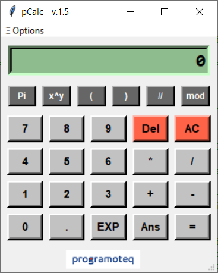
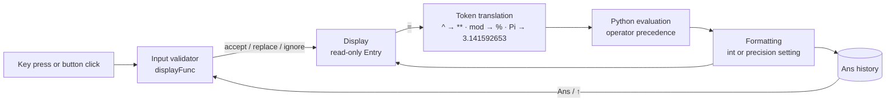

<div align="center">

# pCalc

**A scientific desktop calculator with natural-order equation input and a context-aware input validator.**

Pure Python · Tkinter · zero dependencies · one file




</div>

---

## Why this project exists

In spring 2020 I wanted to understand what really happens inside my own scientific calculator, a Casio fx-992S — not the arithmetic, but the **input**. How does a device stop you from typing `5 * / + 3`? How does it know that `1 + 2 × 3` is `7` and not `9`?

pCalc is my answer. It is written by hand, from scratch, in plain Python and Tkinter. It was built a year before GitHub Copilot and two and a half years before ChatGPT existed — every rule in the input validator is the result of testing, breaking and fixing.

## Features

| | Feature | What it does |
|---|---|---|
| 🧮 | **Natural order of operations** | Type the expression as you write it on paper. `1 + 2 * 3` gives `7`. Operator precedence is applied automatically. |
| 🛡️ | **Input control rules** | The validator checks every key against the current expression and blocks or corrects input that would create a syntax error. |
| 🔁 | **Answer memory (Ans)** | Every result is stored. Press `Ans` (or ↑) again and again to scroll back through all previous results. |
| 🎯 | **Precision setup** | Show results with 1–5 decimal places, or at full precision. |
| 🔬 | **Engineering notation** | `1.2 EXP 3` = `1.2 × 10³` = `1200`. |
| ⚠️ | **Error feedback** | An invalid expression (for example `1/0`) shows `-ERROR-` for 0.6 s, then your input comes back so you can correct it. |
| ⌨️ | **Full keyboard support** | Every button has a keyboard shortcut, plus some letter aliases for one-hand use. |
| ↔️ | **Resizable layout** | The window stretches horizontally. All buttons scale evenly. |

### Operators

| Operator | Button | Example | Result |
|---|---|---|---|
| Addition, subtraction | `+` `-` | `7 - 2 + 1` | `6` |
| Multiplication, division | `*` `/` | `9 / 4` | `2.25` |
| Floor division | `//` | `5 // 3` | `1` |
| Modulus | `mod` | `5 mod 3` | `2` |
| Power | `x^y` | `2 ^ 3` | `8` |
| n-th root | `x^y` + `( )` | `8 ^ (1/3)` | `2` |
| Parentheses | `(` `)` | `(1 + 2) * 3` | `9` |
| Pi | `Pi` | `2 * Pi` | `6.283185306` |

## The input validator

This is the core of the project. Before a character goes on the display, pCalc looks at the last one to three characters of the expression and decides what to do. A few of the rules:

| You type | Display becomes | Rule |
|---|---|---|
| `5` `*` `+` | `5+` | A new operator **replaces** the previous one. |
| `.` on an empty display | `0.` | A leading zero is added for you. |
| `5` `+` `.` | `5+0.` | Same after an operator. |
| `-` on an empty display | `-` | Minus works as a sign for a negative number. |
| `5` `(` | `5` | An opening parenthesis cannot follow a number directly. |
| `5` `+` `)` | `5+` | A closing parenthesis needs an operand before it. |
| `1` `.` `EXP` | `1e+` | `EXP` replaces a trailing decimal point. |
| `Del` after `mod` or `Pi` | removes the **whole token** | Multi-character tokens are deleted as one unit. |
| `2` `+` `3` `=` then `*` `4` | `5*4` | After a result, an operator **continues** the calculation. |
| `2` `+` `3` `=` then `7` | `7` | After a result, a digit **starts a new** calculation. |
| `Ans` after an operator | `5+<last result>` | `Ans` inserts the stored result into the expression. |

Results that are whole numbers show without a decimal part (`4`, not `4.0`). If an expression cannot be evaluated, the display shows `-ERROR-` for a moment and then restores your input, so you can fix it instead of typing it again.

## Keyboard shortcuts

| Action | Keys |
|---|---|
| Digits | `0`–`9` |
| Decimal point | `.` or `,` |
| Add | `+` `a` `A` |
| Subtract | `-` `s` `S` |
| Multiply | `*` `x` `X` |
| Divide | `/` `d` `D` |
| Power | `^` |
| Modulus | `m` `M` |
| Pi | `p` `P` |
| EXP | `e` `E` |
| Parentheses | `(` `)` |
| Equals | `=` or `Enter` |
| Ans (scroll results) | `↑` |
| Delete last token | `Backspace` |
| Clear all (AC) | `Delete` or `Esc` |
| Shortcut list | `F1` |
| Exit | `Ctrl+Q` |

## Getting started

pCalc needs only Python 3.6 or newer. Tkinter ships with the standard Python installer on Windows and macOS.

```bash
git clone https://github.com/programoteq/pCalc.git
cd pCalc
python pCalc.py
```

On Debian or Ubuntu, install Tkinter first:

```bash
sudo apt install python3-tk
```

> pCalc was developed and tested on Windows. The fonts `Consolas` and `Biome` are Windows fonts; on other systems Tk falls back to a default font.

## How it works



### Object-oriented design

The application is built from two classes that share one Tk root window. `main()` creates the root, attaches both objects to it and starts the event loop:

```python
def main():
    root = tk.Tk()
    pCalc(root)        # calculator: display, keypad, validator, evaluator
    CreateMenu(root)   # menu bar, dialogs, application-wide shortcuts
    root.mainloop()
```

| Class | Responsibility | Key methods |
|---|---|---|
| **`pCalc`** | The calculator itself. It owns the display and the calculation state: the result history (`Ans`), the history cursor (`AnsCount`) and the "result just shown" flag (`equalCount`). | `displayWidget()`, `extraFrameWidget()`, `digitFrameWidget()`, `imageFrameWidget()`, `displayFunc()` |
| **`CreateMenu`** | Everything around the calculator: the **Ξ Options** menu, the About window, the precision dialog, the shortcut list and the exit confirmation. | `AboutMsg()`, `PrecisionFunc()`, `pCombFunc()`, `ManualMsg()`, `ExitMsg()` |

Design decisions in the code:

- **Composition over inheritance.** The classes do not subclass `tk.Frame`. Each one receives the `master` window in its constructor and builds its widgets on it.
- **One widget-builder method per area of the window.** `__init__` only defines the data and calls the builders in order, so the layout reads from top to bottom.
- **Data-driven UI.** The keypad is described as tuples of labels. One loop creates the buttons, and the dictionary `keyDic` binds each button to its keyboard key. A new button needs one new entry, not new code.
- **State lives in the object.** The history and counters are instance attributes, so the validator always knows the context of the current key.
- **One entry point for all input.** Every button click and every key press goes through `displayFunc(event, key)`. The validator can never be bypassed.

### Tkinter toolkit

pCalc uses only the Python standard library. The GUI combines classic `tkinter` widgets, the themed `tkinter.ttk` widgets and `tkinter.messagebox`:

| Area | Tkinter features used |
|---|---|
| **Main window** | `tk.Tk`, `title()`, `resizable()`, `minsize()`, `iconphoto()` with `tk.PhotoImage` |
| **Display** | `tk.Entry` in `readonly` state with `readonlybackground`, bound to a `tk.StringVar` (`textvariable`) |
| **Keypad** | `tk.Button` generated in loops, `command=lambda k=key: ...` (default argument captures the value of each key) |
| **Layout** | `grid()` with `sticky` and `grid_columnconfigure(weight=1)` for even, resizable columns; `pack()` in dialogs; nested `tk.Frame` containers |
| **Keyboard** | `bind()` for calculator keys, `bind_all()` for application shortcuts (`F1`, `Ctrl+Q`), special keys such as `<Return>`, `<BackSpace>`, `<Up>`, `<Escape>` |
| **Menu** | `tk.Menu` with `tearoff=0`, `add_cascade()`, `add_command()` with `accelerator`, `add_separator()` |
| **Dialogs** | `tk.Toplevel` windows, `ttk.Notebook` with `ttk.Frame` tabs, `ttk.Combobox` (read-only, `current()`), `ttk.Button`, `tk.Message` |
| **Rich text** | `tk.Text` with `tag_config()` for heading styles, then `state='disabled'` to make it read-only |
| **Message boxes** | `messagebox.showinfo()` for the shortcut list, `messagebox.askokcancel()` for the exit confirmation |
| **Window events** | `protocol("WM_DELETE_WINDOW", ...)` so the close button asks for confirmation too |
| **Timers** | `after(600, ...)` to show `-ERROR-` briefly and then restore the input |
| **Details** | `ttk.Sizegrip` in the corner; images kept as instance attributes so Python does not garbage-collect them |

### Project structure

```
pCalc/
├── pCalc.py                 # the whole application (~750 lines)
├── pCalc.png                # screenshot
└── img/
    ├── calculator-4x.png    # window icon
    └── programoteq.100.png  # author logo
```

## Development story

The project grew in small steps over about six weeks. The local drafts still exist, so the timeline is exact:

| Date | Step |
|---|---|
| 16 April 2020 | **v1.0** — first working pCalc with the menu and the About window (~6.7 KB of code). |
| 19–22 April 2020 | **v1.1 – v1.4** — precision setup added; the code grows to ~24 KB. |
| 5 May 2020 | **v1.5** — published on GitHub (~32 KB). |
| 24 May 2020 | **v1.51** — window icon, minimum window size, extra keyboard shortcuts. |

## Looking back (2026)

This is a 2020 project and I keep it as it was. With six more years of experience, this is what I would do differently today:

- **Replace `eval()`** with a small parser built on Python's `ast` module. In pCalc `eval()` is contained, because the display is read-only and can only hold characters that passed the validator. But a dedicated parser is the correct tool.
- **Turn the validator into a table of rules.** The rules for `+`, `*`, `//`, `mod` and `^` repeat similar branches. A token-based state machine would make them shorter and easier to test.
- **Separate logic from the GUI.** Today the `pCalc` class holds both the widgets and the calculator logic. I would move the validator and the evaluator into a plain `Calculator` class with no Tkinter in it, The settings would stay in one place, as they are now, but in a settings object passed to both classes instead of a global variable that one class writes and the other reads.
- **Add unit tests** for the validator and the evaluator. Today I would write them before the rules, not after.
- **Use `math.pi`** instead of a hard-coded constant, and add functions such as `sin`, `log` and `√`.
- **Package it** with `pyproject.toml` and offer a standalone executable built with PyInstaller.

## License

Released under the [MIT License](LICENSE).

## Author

**programoteq** — [github.com/programoteq](https://github.com/programoteq)

If you like this project, a ⭐ on the repository helps other people find it.
